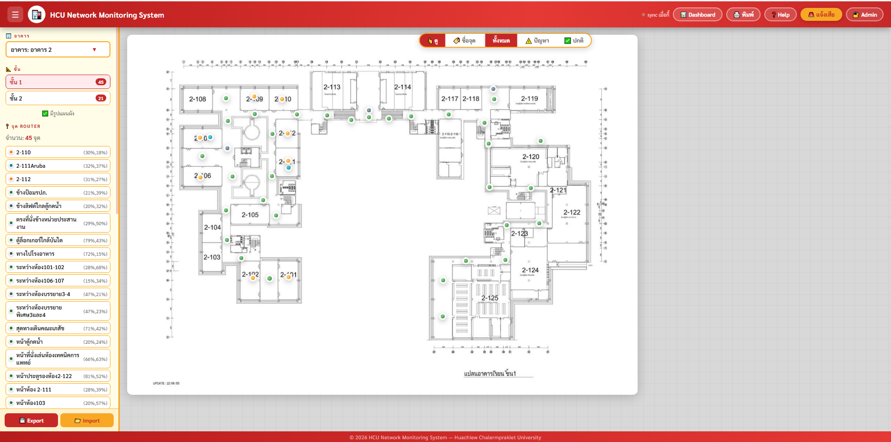

# HCU Network Monitoring System

A web app for mapping and monitoring Wi-Fi routers across campus buildings. Admins place routers on floor plans, record signal strength, and track broken or problematic access points, with data synced in real time.

ระบบติดตามจุด Router / Wi-Fi ภายในมหาวิทยาลัย แยกตามอาคารและชั้น พร้อมแจ้งจุดที่เสียหรือมีปัญหา

**Live demo:** https://polypiku09-crypto.github.io/hcu-network/



## Features
- Admin login with Firebase Authentication
- Add buildings and floors, and upload a floor plan for each floor
- Drag-and-drop router points onto the floor plan
- Record each point's details: signal level (0–5), notes, and a router photo
- Report a broken or problematic router and see its status on the map
- Customize point color and size, and filter the map view
- Dashboard summarizing all points, with "last updated" times
- Real-time sync between devices through Cloud Firestore
- Built-in "how to use" guide

## Tech Stack

| Part | Technology |
|------|------------|
| Frontend | HTML, CSS, JavaScript (no framework) |
| Database | Firebase Cloud Firestore (real-time listeners) |
| Auth | Firebase Authentication |
| Hosting | GitHub Pages |

## Run Locally

```bash
git clone https://github.com/polypiku09-crypto/hcu-network.git
cd hcu-network
npx serve .
```

## My Role

<!-- Write 2–3 lines in your own words: what you designed and built yourself. -->

---
Built as a university project.
